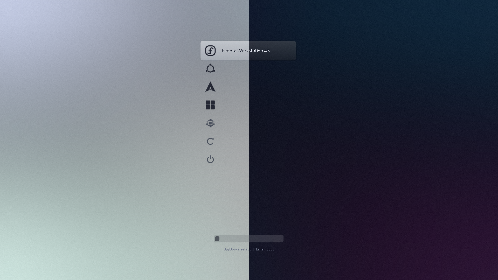
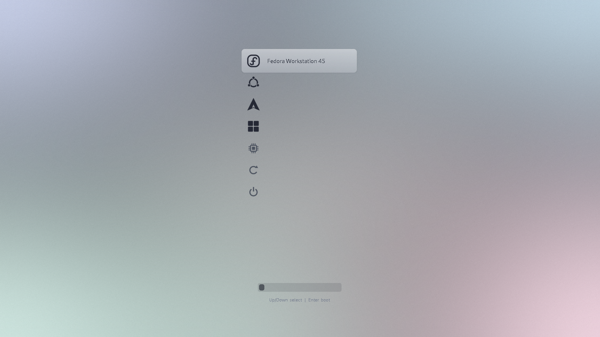
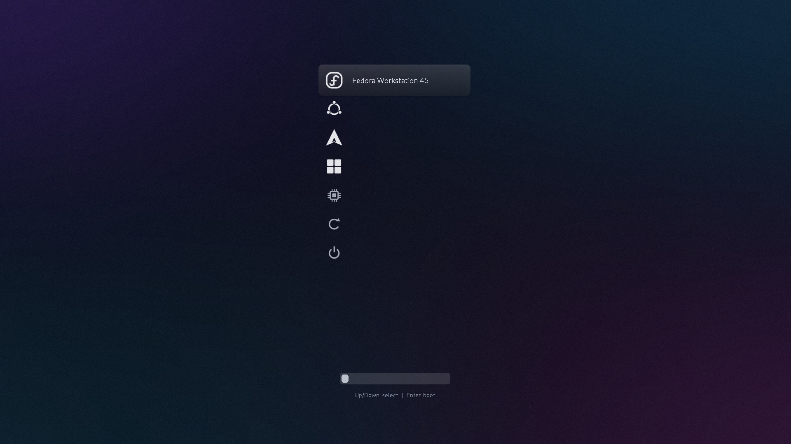

<div align="center">



# aura-grub

**미니멀 아이콘 부트로더 테마**

[English](README.md) | **한국어**

</div>

---

## 미리보기

| `aura-light` | `aura-dark` |
| :---: | :---: |
|  |  |

---

## 빠른 설치

**Fedora 45** 환경에서 검증되었으며, **Ubuntu / Debian / Arch** 등 GRUB2 환경에서 동작합니다

```bash
git clone https://github.com/eombridge/aura-grub.git
cd aura-grub
sudo ./install.sh --theme aura-light --timeout 5 --power-buttons
```

다크 테마를 설치하려면

```bash
sudo ./install.sh --theme aura-dark --timeout 5 --power-buttons
```

### 설치 옵션

| 옵션 | 설명 | 기본값 |
| --- | --- | --- |
| `--theme <aura-light\|aura-dark>` | 설치할 테마 선택 | `aura-light` |
| `--timeout <초>` | GRUB 부팅 대기 시간 (초) | `5` |
| `--default <번호\|saved>` | 기본 부팅 항목 | `0` |
| `--power-buttons` | `/etc/grub.d/40_custom`에 `UEFI Firmware`, `Reboot`, `Shut Down` 추가 | `false` |
| `-h, --help` | 도움말 출력 | — |

### 제거 및 원상복구

설치 전 `/etc/default/grub`으로 복구하고 테마를 제거합니다

```bash
sudo ./install.sh --uninstall
```

---

## 수동 설치

`install.sh`를 실행하지 않고 직접 적용하려면 아래 3단계 명령어를 사용하세요

```bash
# 1. 테마 복사 (RHEL 계열은 /boot/grub2/themes 사용)
sudo mkdir -p /boot/grub/themes
sudo cp -r themes/aura-light /boot/grub/themes/aura-light

# 2. /etc/default/grub에 GRUB_THEME 지정
echo 'GRUB_THEME="/boot/grub/themes/aura-light/theme.txt"' | sudo tee -a /etc/default/grub

# 3. GRUB 설정 재생성 (Debian 계열은 `sudo update-grub`, RHEL 계열은 `grub2-mkconfig -o /boot/grub2/grub.cfg`)
sudo grub-mkconfig -o /boot/grub/grub.cfg
```

---


## 에셋 다시 생성하기

해상도나 아이콘 크기를 바꾸고 싶다면 `src/generate_assets.py`를 실행하세요 (Python 3 + Pillow 필요)

```bash
python3 src/generate_assets.py --width 1920 --height 1080 --icon-size 64
```