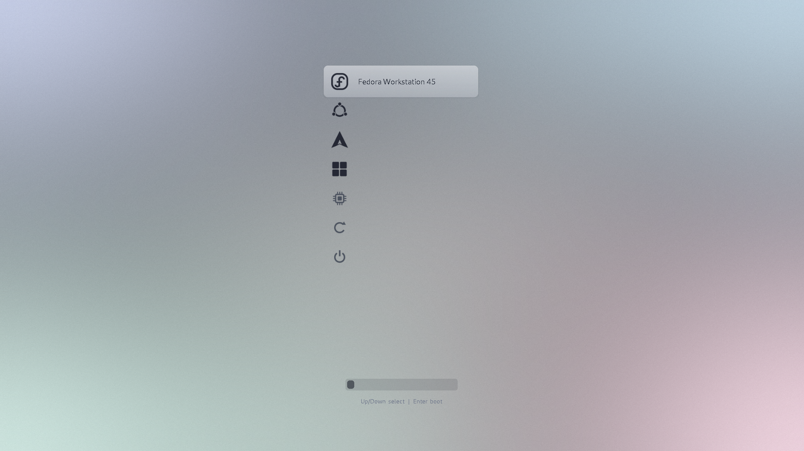
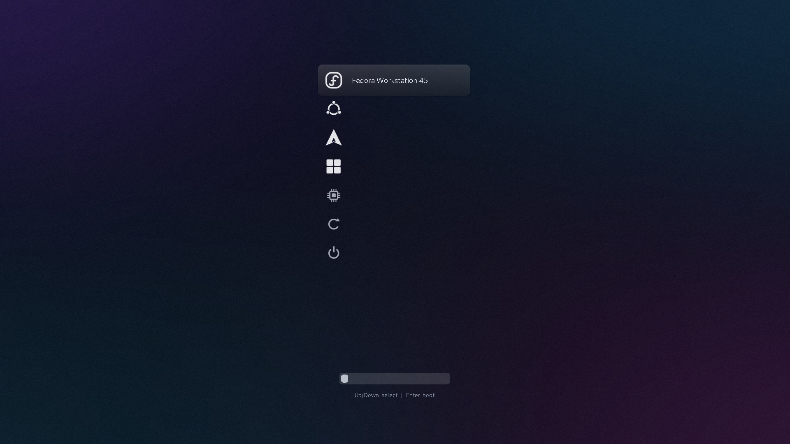

<div align="center">

# aura-grub

**Minimalist Icon Bootloader Theme**

**English** | [한국어](README.ko.md)

</div>

---

## Preview

| `aura-light` | `aura-dark` |
| :---: | :---: |
|  |  |

---

## Quick Install

Verified on **Fedora 45**, and works across **Ubuntu / Debian / Arch** and other GRUB2 distributions

```bash
git clone https://github.com/eombridge/aura-grub.git
cd aura-grub
sudo ./install.sh --theme aura-light --timeout 5 --power-buttons
```

To install the dark theme:

```bash
sudo ./install.sh --theme aura-dark --timeout 5 --power-buttons
```

### Installer Options

| Flag | Description | Default |
| --- | --- | --- |
| `--theme <aura-light\|aura-dark>` | Theme variant to install | `aura-light` |
| `--timeout <seconds>` | GRUB menu timeout in seconds | `5` |
| `--default <index\|saved>` | Default boot entry | `0` |
| `--power-buttons` | Add `UEFI Firmware`, `Reboot`, `Shut Down` to `/etc/grub.d/40_custom` | `false` |
| `-h, --help` | Show help message | — |

### Uninstall

Restore your previous `/etc/default/grub` and remove the installed theme

```bash
sudo ./install.sh --uninstall
```

---

## Manual Installation

To install manually without running `install.sh`, use these 3 steps

```bash
# 1. Copy the theme (use /boot/grub2/themes on RHEL)
sudo mkdir -p /boot/grub/themes
sudo cp -r themes/aura-light /boot/grub/themes/aura-light

# 2. Set GRUB_THEME in /etc/default/grub (edit the line if it already exists)
echo 'GRUB_THEME="/boot/grub/themes/aura-light/theme.txt"' | sudo tee -a /etc/default/grub

# 3. Regenerate GRUB config (`sudo update-grub` on Debian, `sudo grub2-mkconfig -o /boot/grub2/grub.cfg` on RHEL)
sudo grub-mkconfig -o /boot/grub/grub.cfg
```

---


## Regenerating Assets

To customize the resolution or icon size, run `src/generate_assets.py` (requires Python 3 + Pillow)

```bash
python3 src/generate_assets.py --width 1920 --height 1080 --icon-size 64
```